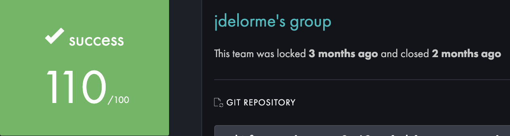
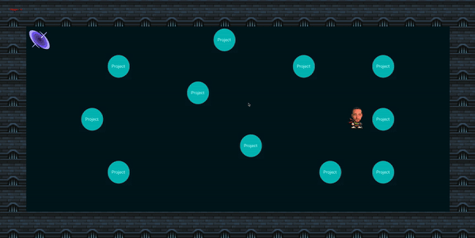
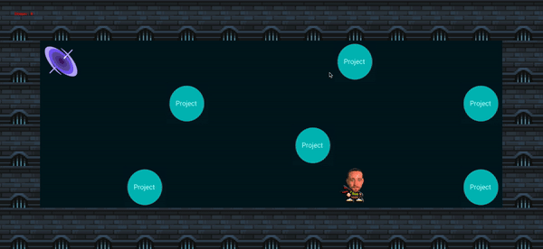
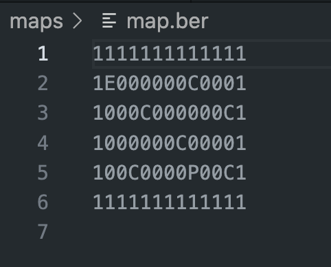

# so_long


> *And thanks for all the fish!*

A small 2D game written in C with the **MiniLibX** graphics library, built as part of the 42 Madrid
common core. You move around a tile map, pick up every collectible and then reach the exit. The map is a
plain text file, so anyone can design their own levels.

**Grade: 110/100**



## Gameplay





## Build and run

It links against the macOS version of MiniLibX (OpenGL and AppKit), so it builds on macOS.

```bash
git clone https://github.com/VolmerES/So_Long.git
cd So_Long
make
./so_long Maps/map.ber
```

| Rule | What it does |
|---|---|
| `make` | Build the game |
| `make run` | Play `Maps/map.ber` (build first) |
| `make clean` | Remove object files |
| `make fclean` | Remove object files and the binary |
| `make re` | `fclean` + `make` |

## Make your own map

Maps are `.ber` files made of these characters:

| Char | Meaning |
|:-:|---|
| `1` | Wall |
| `0` | Floor |
| `P` | Player start (exactly one) |
| `C` | Collectible (at least one) |
| `E` | Exit (exactly one) |



The map is validated before the game starts. It must be rectangular and fully enclosed by walls, and
every collectible and the exit must be reachable from the player. If any rule fails, the game prints
an error saying which one. `Maps/` has a valid map and some invalid ones to try.

## Repository layout

| Path | Contents |
|---|---|
| `src/` | Game source: map and path validation, rendering and player movement |
| `inc/` | `so_long.h` with the game data structures |
| `img/` | Sprites and textures |
| `Maps/` | Sample maps, valid and invalid |
| `libft/` | My own C library |
| `mlx/` | MiniLibX |

---

Made by **Juan Bautista Delorme** (`jdelorme`) at 42 Madrid ·
[Portfolio](https://juandelorme-portfolio.volmer.es) · [LinkedIn](https://www.linkedin.com/in/jdelorme/) · [42 intra](https://profile.intra.42.fr/users/jdelorme)
